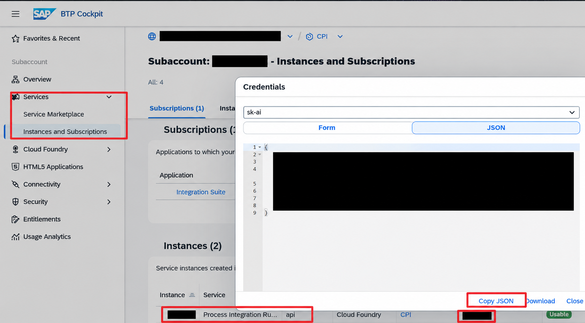
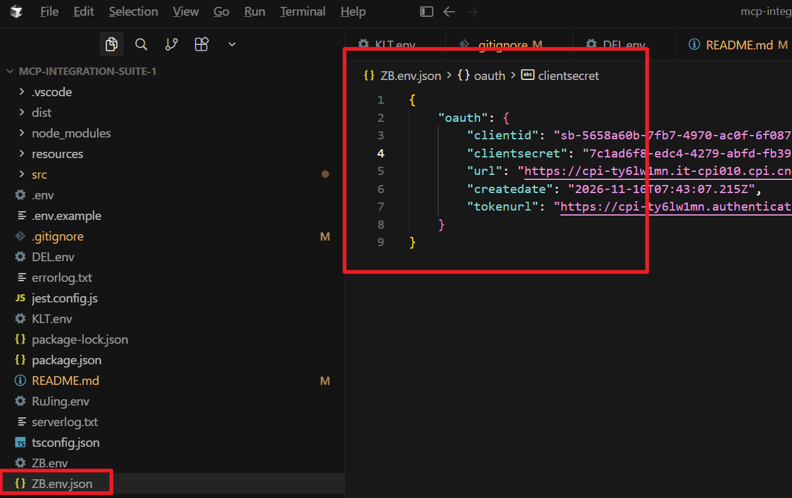

# mcp-integration-suite 介绍与安装

[English README](README.en.md)

> 上游源仓库: https://github.com/1nbuc/mcp-integration-suite
> 上游作者: 1nbuc(及其社区贡献者)
> 配套博客: https://community.sap.com/t5/technology-blog-posts-by-members/using-integration-suite-with-the-power-of-ai/ba-p/14067293

## 本文档的定位（先看这段）

本文档描述的是客制化 fork 的当前本地实现，不是上游原样:


| 项          | 实际情况                                                                    |
| ----------- | --------------------------------------------------------------------------- |
| 在用的 fork | https://github.com/etp-sap/mcp-integration-suite                            |
| 基线上游    | 1nbuc 上游`main` @ `38b7716`(PR #16 之后)                                   |
| 本地增强    | fork 支持多环境；`.env.json` 支持为当前工作区未提交修改，发布前需提交并推送 |
| 工程目录    | 各使用者本机克隆目录(下文简写`<MCP_ROOT>`)                                  |
| 工具数量    | **28 个**(与上游一致,多环境改造不增删工具)                                  |
| 运行时      | Node.js：仓库要求**> 20**；入口 **`dist/index.js`**                         |

> 因此:**上游 README 里"一个 `.env` 对应一个租户"的写法只适用于单租户场景**。多租户请直接看 **2.4(环境文件命名与解析规则)** 与 **2.5(客户端接入实配)** —— 使用 `<别名>.env.json` 或 `<别名>.env` 加启动参数，不需要复制多份工程。

---

## ⚠️ 重要风险提示(必读)

**本 MCP 服务尚处于实验阶段,稳定性未知,使用需自行承担风险。**

原始仓库 `README.md` 第 1 行明确声明:

> **DISCLAIMER: This server is still experimental. Use at your own risk!**

同时,仓库作者附带的实测表也说明:

- 同样的提示词,在 **Claude Desktop 3.7 / Cline + Claude 3.7 / Cline + Deepseek / Cline + Gemini 2.5 pro** 上表现差异很大,部分模型会失败或被客户端的 rate limit / token 窗口限流。
- 失败的能力包括但不限于:**创建带 XSD 的消息映射**、**带 Message Mapping 的 iflow 创建**。
- 仓库的 `TODO` 区还列出了尚未完成的事项:**CSRF 实现**、**其他 artifact 类型的集成**。

> **使用准则(给 junior 同事的硬性要求)**
>
> 1. **不要在生产租户上裸跑** — 先在 dev/test 租户试。
> 2. **不要把部署/更新写进自动流水线** — MCP 的 `deploy-iflow` / `update-iflow` 适合探索,不适合 CI。
> 3. **更新 iFlow 时,只动你确定要改的部分** — `update-iflow` 接收的是"全量文件",漏改或拼错都可能导致整条 iFlow 不可用。
> 4. **部署失败第一时间查 `get-deploy-error`** — 比看控制台直观。
> 5. **对 `send-http-message` 的 POST 返回 401/403 不要奇怪** — 仓库目前没实现 CSRF,部分端点就是打不通。
> 6. **`iflow-image` 依赖本地 Puppeteer + Chrome** — 没装 Chrome 的话会直接报错(本机已踩坑)。

---

## 一、介绍

### 1.1 定位

`mcp-integration-suite` 是一个 **MCP(Model Context Protocol)服务器**,把 SAP Integration Suite(原 SAP Cloud Platform Integration / CPI)的 **Cloud Integration** 设计态与管理能力,**暴露成 28 个工具**,让 VSCode + Copilot(以及 Claude Desktop、Cline 等支持 MCP 的 AI 客户端)能用自然语言完成下面这些事:

- 浏览、创建、更新、部署 iFlow 与 Message Mapping
- 拉取 iFlow 流程图、配置、端点
- 查看 Message Processing Log(消息监控)并按条件过滤/计数
- 直接对租户发起 HTTP 测试请求
- 检索 SAP 官方文档索引

它**不是**一个完整的 CPI 替代品(脚本集合、Value Mapping、Trading Partner Management 等不在这台服务器里 — 后者有专门的 [mcp-is-tpm](https://github.com/1nbuc/mcp-is-tpm)),而是把最常用的"设计 + 部署 + 监控"流程**用 AI 操作**起来。

### 1.2 技术栈一览


| 项          | 值                                                                                |
| ----------- | --------------------------------------------------------------------------------- |
| 运行时      | Node.js**> 20**(依赖原生 `fetch`)                                                 |
| 协议        | MCP 1.x,基于`@modelcontextprotocol/sdk`                                           |
| CPI 客户端  | SAP Cloud SDK(`@sap-cloud-sdk/odata-v2` v3.26.4)                                  |
| HTTP 客户端 | axios                                                                             |
| 流程图渲染  | Puppeteer(需要本地 Chrome / Chrome-Headless-Shell)                                |
| 数据格式    | OData V2 / V4(SAP Integration Suite 的原生 API)                                   |
| 配置注入    | `.env.json` / `.env`，或 `<别名>.env.json` / `<别名>.env`                         |
| 环境切换    | 位置别名参数 /`--env` / `MCP_ENV_FILE`;服务名 `--server-name` / `MCP_SERVER_NAME` |

### 1.3 能力总览(28 个工具,7 个能力域)


| # | 能力域                       | 工具数 | 主要工具                                                                                                                                                                  |
| - | ---------------------------- | ------ | ------------------------------------------------------------------------------------------------------------------------------------------------------------------------- |
| 1 | 集成包(Package)管理          | 4      | `packages`、`package`、`create-package`、`discover-packages`                                                                                                              |
| 2 | 集成流(iFlow)全生命周期      | 9      | `get-all-iflows`、`get-iflow`、`create-empty-iflow`、`update-iflow`、`deploy-iflow`、`get-deploy-error`、`iflow-image`、`get-iflow-configurations`、`get-iflow-endpoints` |
| 3 | 消息映射(Message Mapping)    | 6      | `get-all-messagemappings`、`get-messagemapping`、`create-empty-mapping`、`update-message-mapping`、`deploy-message-mapping`、`create-mapping-testiflow`                   |
| 4 | 示例模板库(Examples)         | 4      | `list-iflow-examples`、`get-iflow-example`、`list-mapping-examples`、`get-mapping-example`                                                                                |
| 5 | 消息监控(Message Monitoring) | 2      | `get-messages`、`count-messages`                                                                                                                                          |
| 6 | HTTP 测试(端到端验证)        | 1      | `send-http-message`                                                                                                                                                       |
| 7 | 文档检索(SAP 官方)           | 2      | `search-docs`、`get-docs`                                                                                                                                                 |

### 1.4 能力详细介绍

#### ① 集成包(Package)管理

- **`packages`** — 拉取租户下**所有集成包**的清单。一般是"探索"动作的第一步。
- **`package(name)`** — 按 ID 获取**单个集成包**的详细元数据(Sender、Receiver、描述等)。
- **`create-package(id, name?, shortText?)`** — **创建**新集成包。`id` 必填,且一旦创建不可改;`name` 不填则默认用 `id`。
- **`discover-packages`** — 拉取 **Discover Center**(SAP 官方预构建内容市场)上的可用包,适合寻找"现成的"集成场景。

> **典型流程**:`packages` → 找到目标 `pkgId` → `get-all-iflows(pkgId)` → 选 iFlow 操作。

#### ② 集成流(iFlow)全生命周期

iFlow 是 SAP Integration Suite 里**最核心**的 artifact。`iFlow ID` 在所有包之间**全局唯一**,所以一旦你拿到 ID,直接调用下面这些工具即可,**不需要再传包名**。


| 工具                       | 作用                                             | 关键参数                      |
| -------------------------- | ------------------------------------------------ | ----------------------------- |
| `get-all-iflows`           | 列出某包下所有 iFlow                             | `pkgId`                       |
| `get-iflow`                | 拿到 iFlow 的完整内容(XML、参数、依赖)           | `id`                          |
| `create-empty-iflow`       | 在某包下创建**空壳** iFlow                       | `packageId`、`id`             |
| `update-iflow`             | **更新 / 创建** iFlow 内部文件;支持 `autoDeploy` | `id`、`files[]`、`autoDeploy` |
| `deploy-iflow`             | 触发 iFlow 部署                                  | `iflowId`                     |
| `get-deploy-error`         | 部署失败时**拉错误信息**(成功则返回空)           | `id`                          |
| `iflow-image`              | 把 iFlow 渲染成**流程图 PNG**                    | `iflowId`                     |
| `get-iflow-configurations` | 拉 iFlow 的**外部化配置参数**                    | `iflowId`                     |
| `get-iflow-endpoints`      | 拉 iFlow 暴露的**端点 URL + 协议**               | `iflowId`                     |

> **iFlow 内部目录约定(写 `update-iflow` 时必看)**
>
> ```
> src/main/resources/                                # 根
> src/main/resources/mapping/                        # <name>.mmap(消息映射)
> src/main/resources/xsd/                            # *.xsd(数据类型)
> src/main/resources/scripts/                        # *.groovy / *.js(脚本)
> src/main/resources/scenarioflows/integrationflow/  # <iflow id>.iflw(流程定义)
> ```
>
> `update-iflow` 的 `files[]` 里 **`filepath` 是相对 iFlow 根的路径**(相对 `src/main/resources/`),**`content` 必须是文件的完整内容**(不要只发 diff),`appendMode: true` 可追加(适合大文件分片)。

> **端点 URL 前缀(手敲地址时容易踩坑)**
>
>
> | 协议 | 前缀            | 示例                                        |
> | ---- | --------------- | ------------------------------------------- |
> | REST | `/http/`        | `https://<cpi-host>/http/myendpoint`        |
> | SOAP | `/cfx/soapapi/` | `https://<cpi-host>/cfx/soapapi/myendpoint` |
> | AS2  | `/as2/as2/`     | `https://<cpi-host>/as2/as2/myendpoint`     |
>
> 实际返回路径和端点是否可用应结合 iFlow 配置核对，避免重复拼接协议前缀。

#### ③ 消息映射(Message Mapping)全生命周期

消息映射是 iFlow 里**做格式转换**的图形/代码逻辑,本身可以作为独立 artifact 存在,但 **90% 的场景下推荐嵌在 iFlow 里**(README 原文建议)。


| 工具                       | 作用                                                                        | 关键参数                      |
| -------------------------- | --------------------------------------------------------------------------- | ----------------------------- |
| `get-all-messagemappings`  | 列出所有 standalone 消息映射                                                | —                            |
| `get-messagemapping`       | 取单个映射的完整内容                                                        | `id`                          |
| `create-empty-mapping`     | 在某包下创建**空壳**映射                                                    | `packageId`、`id`             |
| `update-message-mapping`   | **更新/创建**映射文件;支持 `autoDeploy`                                     | `id`、`files[]`、`autoDeploy` |
| `deploy-message-mapping`   | 触发部署                                                                    | `mappingId`                   |
| `create-mapping-testiflow` | 在指定包下生成一个叫**`if_echo_mapping`** 的 iFlow,**专门用来回显测试映射** | `pkgId`                       |

> ⚠️ 注意:很多新人会先建 standalone 映射再插到 iFlow,**这是反模式**。推荐路径:在 iFlow 内嵌消息映射 → 部署 → 用 `if_echo_mapping` 测。

#### ④ 示例模板库(Examples)

仓库内置了一批**已知能跑通**的样例,新场景**应该先看这里**。

- **`list-iflow-examples`** — 列出可用的 iFlow 模板名
- **`get-iflow-example(name)`** — 取具体模板
  - 可选值:`simple_http_srv_to_http`、`replicate_product_inventory_info`、`if_simple_http_message_mapping`、`if_google_get_oauth_token`、`if_google_ads_campaigns`、`if_fwd_google_request`
- **`list-mapping-examples`** — 列出可用的消息映射模板
- **`get-mapping-example(name)`** — 取具体模板
  - 可选值:`mm_material_clasification`、`mm_material_management`、`mm_pricing_conditions`、`mm_simple_1_to_1`

#### ⑤ 消息监控(Message Monitoring)


| 工具             | 用途                              | 上限                    |
| ---------------- | --------------------------------- | ----------------------- |
| `get-messages`   | 拿消息详情(含错误、附件、payload) | **最多 50 条**,多了会爆 |
| `count-messages` | **只计数**,不上 payload           | 适合大查询、做统计      |

两者支持**同一组过滤条件**(`filterProps`):


| 字段                  | 含义               | 示例                      |
| --------------------- | ------------------ | ------------------------- |
| `LogStart`            | 起始时间           | `"2026-06-15T00:00:00"`   |
| `LogEnd`              | 结束时间           | `"2026-06-16T23:59:59"`   |
| `integrationFlowId`   | 按 iFlow 过滤      | `"MM_006_DEV"`            |
| `status`              | 按状态过滤(可多选) | `["FAILED", "ABANDONED"]` |
| `sender` / `receiver` | 参与方             | —                        |
| `msgGUID`             | 消息唯一 ID        | —                        |

合法 `status` 枚举:`INFO` / `RETRY` / `FAILED` / `ABANDONED` / `COMPLETED` / `PROCESSING` / `ESCALATED` / `DISCARDED`。

#### ⑥ HTTP 测试(端到端验证)

- **`send-http-message(path, method?, body?, headers?, contentType?)`**
  - `path` 必须是**带协议前缀的完整 HTTP Path**(不是 URL),例如 `/http/myendpoint`
  - 默认 `method: POST`、`contentType: application/json`
  - **目前不支持 CSRF 保护的 POST 端点** — 遇到 401/403 不要奇怪

> 调试套路:`create-mapping-testiflow` 生成 `if_echo_mapping` → `update-iflow` 把映射塞进去 → `send-http-message` 打 `if_echo_mapping` 端点 → 看响应体 / 查 `get-messages`。

#### ⑦ 文档检索(SAP 官方)

- **`search-docs(keywords[], matchAll)`** — 关键词搜索 SAP Integration Suite 官方文档。`matchAll: true` 表示 AND,`false` 表示 OR。
- **`get-docs(docPath?)`** — 按**内部路径**直接拉某篇文档。不传 `docPath` 返回**索引**。路径样例:`"40-RemoteSystems/basic-authentication-of-an-idp-user-for-api-clients-57f104d.md"`。

---

## 二、安装(面向 junior 同事的分步指南)

> 本节专门写给 **Windows + VSCode + Copilot(支持 MCP 的版本)** 的同事,逐步跟着点即可。
> 如果你后面换 Claude Desktop / Cline / Cursor,配置 JSON 写法通用,只换"客户端配置文件路径"。

### 2.1 前置条件检查

按下 **Win + R**,输入 `cmd`,回车,依次执行:

```cmd
node --version
npm --version
git --version
```

**期望输出**:

- 仓库要求 Node.js **大于 20**；建议安装受支持的较新 LTS 版本。
- `npm` 任意较新版本(随 Node 一起装即可)
- `git` 任意较新版本


| 检查结果              | 怎么处理                                                   |
| --------------------- | ---------------------------------------------------------- |
| `node` 没有或版本太低 | 去 https://nodejs.org/ 下载较新的 LTS 版,勾选*Add to PATH* |
| `npm` 没有            | 一般 Node 安装包自带,缺失就`npm i -g npm`                  |
| `git` 没有            | https://git-scm.com/download/win 下载安装                  |
| 命令找不到            | 重启终端/电脑后再试,通常是 PATH 没刷新                     |

### 2.2 准备连接信息

每个 CPI 租户准备一个别名，例如 `ZB`。建议使用 OAuth Service Key。原始 JSON 可以直接从 BTP 复制，保存为工程根目录的 `<别名>.env.json`，不需要把 JSON 转成 env。

可以先查看 [Service Key JSON 示例](.env.json.example)，了解文件结构。示例只包含占位符，不能直接连接；实际使用时请以目标租户的原始 Service Key 内容替换。该示例不含管理 API 地址，仍需按下文在同名 `.env` 中配置 `API_BASE_URL`。

**Service Key JSON 从哪里获取**（以截图中的 BTP Cockpit 界面为例）：

1. 登录 SAP BTP Cockpit，进入目标 Integration Suite 租户所在的 **Subaccount**。
2. 在左侧选择 **Services → Instances and Subscriptions**，找到页面下方的 **Instances** 列表。
3. 找到 **Service** 为 **Process Integration Runtime**、**Plan** 为 **`api`** 的服务实例。截图中还存在 `integration-flow` 计划的实例；这里获取管理 API 凭据时应选择 `api` 这一行。

   
4. 点击该行 **Credentials** 列中的 **`1 key`**（实际数量可能不同），打开已有的 Service Key，查看其 JSON 内容。
5. 完整复制该 Service Key 的原始 JSON，保存为 MCP 工程根目录的 `<别名>.env.json`。例如客户端别名使用 `ZB`，文件名就使用 `ZB.env.json`；不要把截图中的实例名或别人的凭据当作自己的配置。

   

如果没有 `api` 计划的实例、没有可用 Service Key，或无权查看凭据，请联系目标子账号的管理员确认实例、权限及所需角色；不要默认其他计划的 key 可以替代。Service Key 含敏感凭据，请通过安全渠道处理，不要贴到共享文档或 AI 对话中。

Service Key 中的 `oauth.clientid`、`oauth.clientsecret` 和 `oauth.tokenurl`（或 `oauth.url`）用于 OAuth。部分 Service Key 只包含 OAuth 凭据，没有 Integration Suite 管理 API 地址：这种情况下必须另外提供同名 `<别名>.env`，填写以下地址：

```ini
API_BASE_URL=https://<management-host>/api/v1
# 仅在需要发送 HTTP 测试消息时配置
CPI_BASE_URL=https://<runtime-host>
```

`API_BASE_URL` 使用管理 API 地址，`CPI_BASE_URL` 使用目标租户的消息运行时地址；实际 host 请从目标租户配置中确认，不要从 OAuth token 地址猜测。如果 JSON 含 `endpoints.api`，可用作管理地址；如果含 `endpoints.https`，可用作运行时地址。地址齐全时可不建同名 env 文件。

同名 env 与 JSON 并存时，JSON 提供 OAuth 凭据，env 只补充地址，env 中的凭据不会用于补充 JSON。环境变量中已存在的值不会被覆盖，因此检查 MCP 客户端是否继承或配置了其他租户的 `API_*` / `CPI_*`。运行时请求会使用 JSON 的 OAuth 凭据，目标 iFlow 的发送权限需要另行确认。

也可以只使用 `<别名>.env`，按照工程的 `.env.example` 配置 OAuth 或 Basic 认证；发送消息使用单独的 `CPI_*` 配置。不要在共享文档、仓库或 AI 提示词里粘贴真实密钥。

### 2.3 下载与构建

1. 克隆客制化仓库并进入目录：

   ```powershell
   git clone https://github.com/etp-sap/mcp-integration-suite.git
   cd mcp-integration-suite
   npm install
   npm run build
   ```
2. 确认存在 `dist/index.js`。`npm run build` 包含 OData 客户端生成和 TypeScript 编译。当前工程的 `npm start` 指向 `dist/server.js`，客户端配置应直接启动 `dist/index.js`。
3. 如需 `iflow-image`，还需要 Puppeteer 可用的浏览器；必要时运行 `npx puppeteer browsers install chrome-headless-shell`。

> **发布前检查**：本文的 `.env.json` 加载逻辑对应编写时本地工作区的未提交修改。将文档发给同事前，需先把相关代码提交并推送到上述 fork，或提供包含这些修改的仓库版本。仅克隆已有旧版本不能保证支持 JSON；请检查其 `src/utils/envConfig.ts` 是否包含 `.env.json` 查找逻辑。本文不代表已完成提交或推送。

### 2.4 文件命名与多租户

每个 MCP 条目启动独立进程，传入别名即可使用同一工程连接不同租户。路径相对于工程根目录，不依赖客户端的当前目录。


| 启动参数 | 优先读取       | JSON 不存在时 | 默认 MCP 内部名称       |
| -------- | -------------- | ------------- | ----------------------- |
| 不传别名 | `.env.json`    | `.env`        | `integration-suite`     |
| `ZB`     | `ZB.env.json`  | `ZB.env`      | `integration-suite-ZB`  |
| `KLT`    | `KLT.env.json` | `KLT.env`     | `integration-suite-KLT` |

JSON 文件存在但无效或缺少必要信息时会报错，不会当作文件不存在而回退到 env 的凭据。`--env ZB` 和 `MCP_ENV_FILE=ZB` 也可选，优先级依次是 `--env`、`MCP_ENV_FILE`、位置别名、默认 `.env`。如需自定义 MCP 内部名称，可加 `--server-name` 或设置 `MCP_SERVER_NAME`；通常无需添加。客户端条目名称由客户端配置中的键决定，与 MCP 内部名称是不同概念。

修改配置后重启相应 MCP 进程。为避免凭据外泄，不要将 `*.env` 或 `*.env.json` 提交到 Git；也不要在聊天中发送这些文件的内容。多人使用时应各自创建或安全取得自己的凭据和地址。

### 2.5 配置 MCP 客户端

把下例中的 `<MCP_ROOT>` 替换为本机仓库绝对路径，例如 `C:/work/mcp-integration-suite`。Windows JSON 路径可使用 `/`，或将反斜杠写为 `\\`。示例使用占位别名，不需要沿用其他人的租户名称。

**VS Code / GitHub Copilot**：在用户级或工作区级 `mcp.json` 中添加（如已有其他 server，请合并条目）：

```json
{
  "servers": {
    "cpi-ZB": {
      "type": "stdio",
      "command": "node",
      "args": ["<MCP_ROOT>/dist/index.js", "ZB"]
    },
    "cpi-KLT": {
      "type": "stdio",
      "command": "node",
      "args": ["<MCP_ROOT>/dist/index.js", "KLT"]
    }
  }
}
```

**Claude Desktop**：在其配置文件中使用 `mcpServers`，不要直接照搬 VS Code 的 `servers` 包装：

```json
{
  "mcpServers": {
    "cpi-ZB": {
      "command": "node",
      "args": ["<MCP_ROOT>/dist/index.js", "ZB"]
    }
  }
}
```

**Codex**：在用户自己的 Codex 配置文件中合并以下 TOML 条目；不要覆盖其他条目：

```toml
[mcp_servers.cpi-ZB]
command = "node"
args = ["<MCP_ROOT>/dist/index.js", "ZB"]
```

各客户端的配置文件位置和重新加载方法可能因版本或操作系统而异；使用客户端当前提供的 MCP 配置入口。其他客户端需核对其配置格式，不应假定与 VS Code 相同。

### 2.6 启动验证与排错

1. 启动或重新加载 MCP server，确认客户端列出了对应 server 和工具。工具出现只能证明注册成功，不代表已连通 CPI。
2. 明确指定目标 server，调用只读的 `packages`。成功返回目标租户的包，才能确认该次管理 API 请求和认证成功。需要时再用 `count-messages` 验证消息监控权限。
3. 如果失败，检查别名、文件名、管理地址和 OAuth 凭据是否来自同一个租户；检查 JSON 是否有效、必需地址是否存在；查看客户端错误和工程的 `errorlog.txt`。修改后重启 server。404 检查 host 和 `/api/v1`，401/403 检查凭据及权限。
4. `send-http-message` 是单独的运行时请求，需要运行时地址、认证和目标 iFlow 的授权；`packages` 成功不代表消息发送或部署成功。

本次编写期间在当前会话中对 ZB 执行了只读 `packages` 和 `count-messages`，均返回成功。这只是当时该会话的结果，不代表其他同事、租户、未来时间或仓库远端版本已经验证。

### 2.7 交给其他 AI 配置

可将本文档和下面这段要求交给能访问本机的 AI。让它先核对实际文件和客户端，再修改；不要把真实凭据粘贴到提示词或输出中。

```text
请依据本说明为我配置客制化 mcp-integration-suite。先确认仓库版本支持 <别名>.env.json、Node/npm 和目标 MCP 客户端配置格式；使用我指定的项目目录与租户别名。保留客户端现有配置，不输出、提交或上传凭据。若原始 Service Key 不含管理 API 地址，使用同名 env 中我提供的 API_BASE_URL；不要猜地址。构建后注册 server、重新加载，并通过目标 server 的 packages 做只读验证。分别报告构建、注册和实际 API 查询的结果；缺少信息或无法重新加载时明确说明。
```

### 2.8 更新与卸载

升级前确认本地改动并备份本机凭据文件；更新仓库后运行 `npm install`、`npm run build`，再重启 MCP server 和执行只读验证。不要把个人凭据文件交由 Git 跟踪。卸载时从目标客户端移除相应 server 条目；工程和本地凭据如何处理由使用者自行决定。

---

## 三、下一步建议(给 junior 同事)

1. **从只读工具开始**:`packages` / `get-all-iflows` / `get-messagemapping` / `search-docs` 都是安全的"探索"工具,熟悉后再碰写操作。
2. **写操作前先看示例**:`list-iflow-examples` 选一个相近的模板 → `get-iflow-example` 看完整结构 → 复制改造。
3. **新场景先在 dev 租户手测**:写一个 `update-iflow` → 部署 → `get-deploy-error` 检查 → `send-http-message` 试调 → `get-messages` 查消息流。
4. **多租户先对"服务名"再动手**:同名 server 很容易让你在生产租户上执行了本该在 dev 上的 `deploy-iflow`。约定:客户端条目名称与租户别名清晰对应；执行写操作前确认目标租户。
5. **新租户一律走 2.4 的 checklist**,不要复制别人改好的 `mcp.json` 条目只改 env 文件名 —— `API_OAUTH_TOKEN_URL` 忘了改会以 `invalid_client` 形式暴露,排查成本很高。
6. **遇到怪问题先看仓库 README**:https://github.com/1nbuc/mcp-integration-suite — 作者持续更新,最新已知问题在 README 的 *Test results* / *TODOs* 区域;多环境能力看 fork 的 README 段落与 `src/utils/envConfig.ts`。
7. **把"实验性"这根弦绷住** — 任何写操作都当成"会失败"来对待,设置好回滚方案(比如先 `get-iflow` 把现状存下来再改)。

---

> 文档版本: v1.2(2026-11-25) · 根据本地工作区 `src/utils/envConfig.ts` 更新；JSON 支持尚待提交和发布 · 行为以所用仓库版本为准
